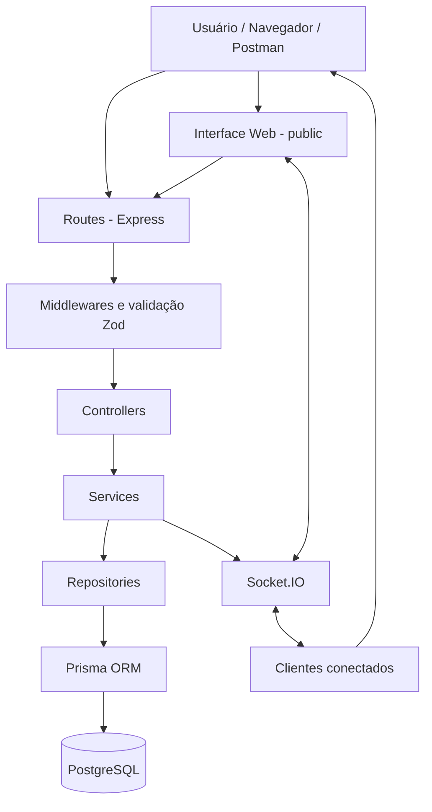

# Arquitetura do Sistema de Empréstimos de Equipamentos

## 1. Objetivo

O sistema tem como objetivo gerenciar empréstimos de equipamentos e permitir o acompanhamento de alterações e notificações em tempo real.

A aplicação utiliza Node.js, Express, Prisma, PostgreSQL e Socket.IO. A interface web permite visualizar usuários, categorias, equipamentos, empréstimos e notificações, facilitando o acompanhamento das operações realizadas no sistema.

## 2. Organização em camadas

O projeto foi organizado em camadas para separar as responsabilidades e facilitar a manutenção e a evolução do código.

- **Routes:** definem os endpoints da API e encaminham as requisições para os controllers.
- **Controllers:** recebem as requisições HTTP, chamam os services responsáveis e retornam as respostas ao cliente.
- **Services:** concentram as regras de negócio, como verificar a disponibilidade dos equipamentos, registrar empréstimos e gerar notificações.
- **Repositories:** realizam as consultas e operações de persistência no banco de dados utilizando o Prisma.
- **Schemas e middlewares:** validam os dados recebidos e auxiliam no tratamento das requisições e dos erros.
- **Config:** reúne as configurações utilizadas pela aplicação, incluindo o cliente Prisma e a organização das dependências.
- **WebSocket:** gerencia as conexões em tempo real, as salas e a emissão de eventos pelo Socket.IO.
- **Public:** contém os arquivos da interface web, como HTML, CSS e JavaScript.
- **Prisma:** contém o schema do banco de dados, as migrações e o arquivo de carga inicial de dados (seed).

Essa divisão permite que cada parte do sistema tenha uma responsabilidade definida, evitando concentrar toda a lógica em um único arquivo.

## 3. Diagrama da arquitetura

## 4. Fluxo de uma requisição

O funcionamento de uma requisição segue as seguintes etapas:

1. O cliente envia uma requisição para um endpoint da API.
2. A rota identifica a operação solicitada.
3. O middleware valida os dados recebidos quando necessário, utilizando os schemas definidos com Zod.
4. O controller recebe a requisição e encaminha a operação ao service correspondente.
5. O service executa as regras de negócio e verifica as condições necessárias para realizar a operação.
6. O repository acessa ou modifica os dados no banco de dados por meio do Prisma.
7. O resultado retorna ao controller, que envia a resposta HTTP ao cliente.
8. Quando ocorre uma alteração que precisa ser comunicada em tempo real, o sistema emite eventos pelo Socket.IO para os clientes conectados.

Esse fluxo mantém as regras de negócio separadas das operações HTTP e do acesso ao banco de dados.

## 5. Padrões de projeto

### 5.1. Repository

O padrão Repository separa o acesso aos dados das regras de negócio. Os services utilizam os repositories para consultar, cadastrar, atualizar e excluir informações sem precisar concentrar diretamente as operações de persistência.

No projeto, essa organização facilita a manutenção e permite identificar com mais clareza onde cada operação com o banco de dados é realizada.

### 5.2. Injeção de dependência

A injeção de dependência permite fornecer a um componente os objetos e serviços de que ele precisa, em vez de deixar que cada componente crie todas as suas próprias dependências.

No projeto, o arquivo `src/config/dependencias.js` centraliza a organização e o fornecimento das dependências utilizadas pela aplicação. Essa abordagem ajuda a reduzir o acoplamento entre as camadas e facilita a manutenção do código.

### 5.3. Singleton

O padrão Singleton busca garantir que um recurso centralizado tenha uma instância compartilhada pela aplicação.

No projeto, o cliente Prisma é disponibilizado pelo módulo `src/config/prisma.js`, permitindo que os repositories compartilhem o mesmo cliente, em vez de criar instâncias independentes para cada operação.

### 5.4. Observer

O padrão Observer está relacionado à comunicação de mudanças para componentes interessados em receber atualizações.

No projeto, o Socket.IO permite emitir eventos quando ocorrem alterações em empréstimos, equipamentos e notificações. Os clientes conectados podem receber esses eventos e atualizar a interface sem precisar recarregar a página manualmente.

Assim, a comunicação em tempo real contribui para que o usuário acompanhe as alterações realizadas no sistema.

## 6. Persistência e transações

O PostgreSQL armazena os dados referentes a usuários, categorias, equipamentos, empréstimos e notificações. O Prisma é utilizado como ORM para realizar as operações de persistência, organizar o acesso aos dados e executar as migrações do banco.

O projeto utiliza relacionamentos entre as entidades para manter a integridade das informações. Também utiliza transações em operações que precisam manter a consistência dos dados, como registrar um empréstimo e criar sua notificação correspondente.

As migrações permitem estruturar e atualizar o banco de dados, enquanto o seed possibilita inserir dados iniciais para facilitar os testes e a utilização da aplicação.

## 7. Comunicação em tempo real

O Socket.IO mantém a comunicação entre o servidor e os clientes conectados. O sistema utiliza salas para organizar a comunicação geral e individual, além de eventos para informar alterações e solicitar a sincronização dos dados.

Entre os eventos utilizados estão:

- `emprestimo:criado`: informa a criação de um empréstimo.
- `emprestimo:atualizado`: informa alterações em um empréstimo.
- `emprestimo:excluido`: informa a exclusão de um empréstimo.
- `equipamento:atualizado`: informa alterações em um equipamento.
- `notificacao:nova`: informa a criação de uma nova notificação.
- `notificacao:lida`: informa que uma notificação foi marcada como lida.
- `sincronizar:solicitar`: permite ao cliente solicitar informações sobre a conexão e a sincronização.

Essa comunicação ajuda a manter a interface atualizada durante a utilização do sistema. Após uma reconexão, o cliente também pode consultar a API REST para obter novamente os dados atuais.

## 8. Decisões arquiteturais (ADR)

### ADR 001 — Separação em camadas

**Decisão:** organizar o projeto em rotas, controllers, services e repositories.

**Motivo:** separar as responsabilidades e facilitar a compreensão, a manutenção e a evolução do código.

**Consequência:** o projeto possui mais arquivos, mas cada parte apresenta uma função mais clara, facilitando a identificação de erros e a implementação de melhorias.

### ADR 002 — Uso do PostgreSQL com Prisma

**Decisão:** utilizar o PostgreSQL como banco de dados relacional e o Prisma como ORM.

**Motivo:** armazenar informações relacionadas de maneira organizada e facilitar as consultas, as migrações e as transações.

**Consequência:** a aplicação depende da configuração correta do banco de dados e do Prisma para executar as operações de persistência.

### ADR 003 — Uso do Socket.IO

**Decisão:** utilizar o Socket.IO para a comunicação em tempo real entre o servidor e os clientes.

**Motivo:** permitir que a interface receba atualizações sobre empréstimos, equipamentos e notificações sem depender apenas de consultas manuais.

**Consequência:** é necessário gerenciar as conexões, os eventos, as salas e a sincronização dos dados após reconexões.

## 9. Considerações finais

A arquitetura do Sistema de Empréstimos de Equipamentos busca separar as responsabilidades, facilitar a manutenção e permitir a evolução da aplicação.

As rotas, os controllers, os services e os repositories trabalham em conjunto para atender às requisições. O Prisma e o PostgreSQL cuidam da persistência dos dados, enquanto o Socket.IO permite comunicar alterações em tempo real.

A utilização dessas práticas contribui para uma aplicação mais organizada, com responsabilidades definidas e maior facilidade para realizar testes, corrigir problemas e implementar novas funcionalidades.